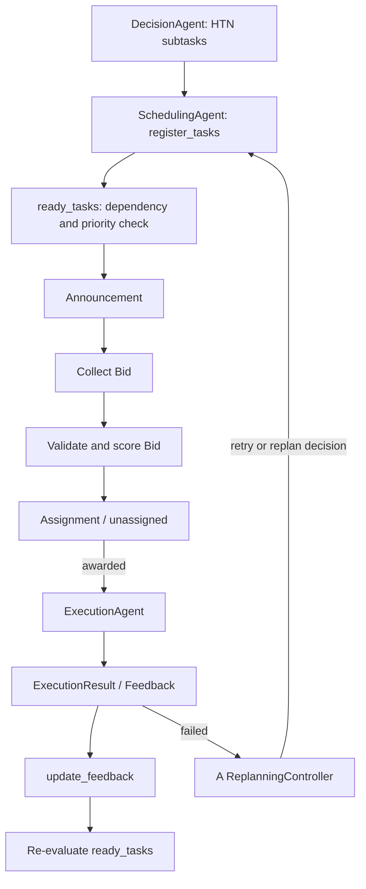

# CNP workflow and integration contract

## Score
`score = 0.50 * capability_match + 0.30 * (1 / (1 + estimated_cost)) + 0.20 * (1 - load)`

Weights are manually selected prototype parameters, not learned optimal weights.

## Core contracts
- Task: `task_id`, `subtask_id`, `task_type`, `priority`, `dependencies`, optional `constraints`, `status`.
- Bid: `task_id`, `subtask_id`, `agent_id`, `estimated_cost`, `capability_match`, `load`.
- Assignment: `task_id`, `subtask_id`, `winner_id`, `score`, `assignment_status`.
- Feedback: `task_id`, `subtask_id`, `execution_status`; failed feedback additionally needs `failure_reason`, and may include `exclude_failed_agent`.

## Failure ownership
A/ReplanningController decides whether to replan, retry, reassign, or terminate. C applies the assignment policy requested by A. C does not generate SMPL control actions and does not replace D's safety decision.
