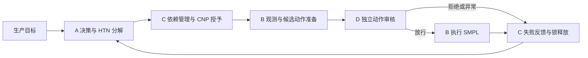

# 流程工业四智能体协同原型

按《项目修改后的版本.doc》的 SMPL、四角色、HTN/CNP 路线，完成决策 A、调度 C、执行 B、监管 D 的本地同步互联。根目录只有一个运行入口，代码集中于 `l3_system/`。



使用 Python 3.11 或 3.12，在仓库根目录运行：

```bash
python -m venv .venv
# Linux/macOS
source .venv/bin/activate
# Windows PowerShell 使用 .\.venv\Scripts\Activate.ps1
python -m pip install -r requirements.txt
python main.py --scenario normal
python main.py --scenario reject
python main.py --scenario inspect
python main.py --cycles 5
```

`reject` 是预期拒绝验收场景，通过时退出码为 0。实际执行失败、连续轮数不足或锁未释放时退出码为 1。`--offline-preview` 仅查看 HTN 计划。运行记录默认保存在 `outputs/` 的独立目录。

```bash
python -m unittest discover -s l3_system/tests -t . -v
python -m experiments.run_validation --output outputs/validation
```

详细接口与限制见 [运行说明](docs/四智能体运行说明.md)、[代码分析与清理说明](docs/代码分析与清理说明.md)、[当前中期状态](docs/项目中期报告.md)。本次实测证据见 [验证汇总](evidence/current/smpl/summary.json)。`requirements-lock.txt` 保存本次 Linux/Python 3.12 验证的完整依赖版本。

当前互联使用单进程 Python 调用，验证环境为真实 AtropineEnv（39 维观测、4 维动作）。动作中点只用于接口基线。Word 中的 mAbEnv 主研究路线保留，相关 SMPL 源码完整保存在 `vendor/`，尚未完成 mAbEnv 适配、工艺优化、多模态模型、ROS/ZeroMQ 或工业 L3 人机接管验证。
