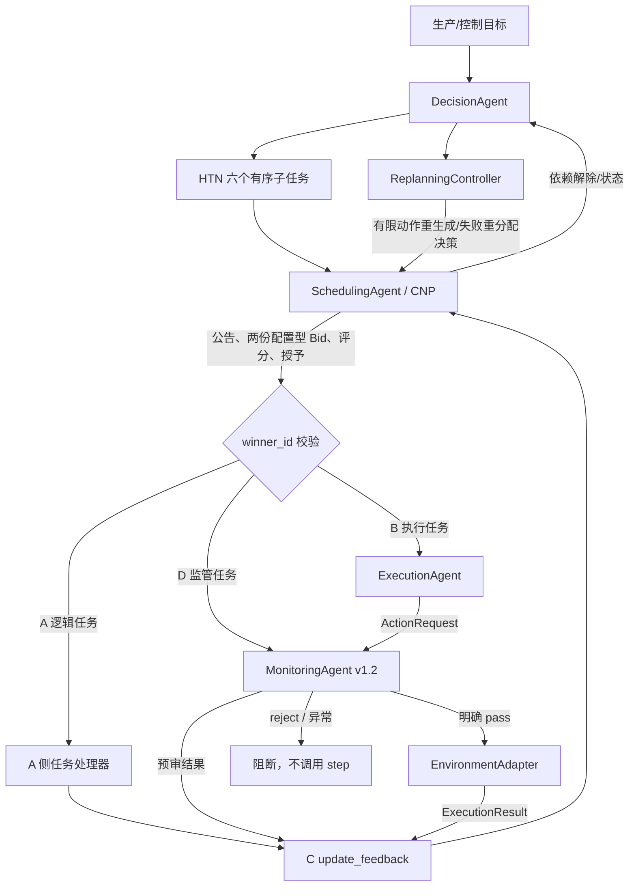

# L3 系统架构与 A 侧集成关系

## 关键边界
- AtropineEnv 是当前短期工程验证环境；mAbEnv 是研究方案中的目标/扩展模型，不能把本次 AtropineEnv 结果写成 mAbEnv 验证。
- D 的 R-01/R-02 在执行前检查动作格式、数值和真实 action_space 边界；R-03 未启用。
- HTN 的 `safety_review` 阶段会执行一次预审；B `execute_assignment()` 内部还会再次调用 D，第二次审核是紧邻 `env.step()` 的权威门控。
- 本项目 CNP Bid 是本地配置的能力档案 Bid；不是来自多个独立在线执行器的实时遥测。
- B 当前 `space_midpoint` 只是接口基线策略，不是经优化或训练得到的过程控制器。
