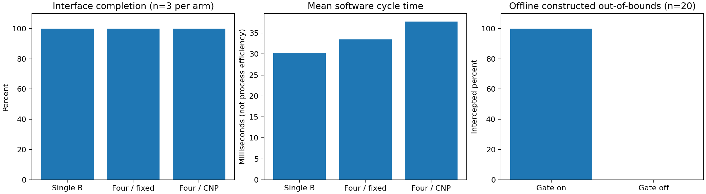

# 实验说明与指标

## 一键复现

创建虚拟环境并安装根目录依赖后，在仓库根目录执行：

```bash
python -m unittest discover -s l3_system/tests -t . -v
python -m experiments.check_docs
python -m experiments.run_validation --output outputs/validation
python -m experiments.compare --output outputs/comparison --seeds 1101 1102 1103
```

输出目录必须不存在，避免覆盖历史数据。主验证脚本使用显式失败检查，在 `python -O` 优化模式下仍有效。Linux Python 3.12 已实测；GitHub 工作流另定义 Python 3.11/3.12 自动验证，远端工作流结果以 Actions 实际状态为准。

## 三组对照的设计

**单执行模块与四角色。** 每个种子分别新建真实 AtropineEnv，三组使用相同的 reset、观测与动作中点策略。`single_executor` 直接调用适配器推进；`four_fixed` 和 `four_cnp` 经过六阶段编排。脚本核对三组初态完全一致、动作一致、奖励与下一观测数值一致。单执行模块代表执行接口基线，没有 A/C/D，其分配成功率为 null，不填成 100%。

**固定规则与 CNP。** 固定规则按可用执行者编号排序，CNP 按能力/成本/负载加权评分；均使用相同的校验、依赖和锁机制。当前主链每个阶段只有一个合格执行者，因此真实仿真的两组应给出一致结果。这是退化基线；另有多投标测试确认固定顺序与 CNP 在成本不同的候选上会做不同选择，但该测试不是多设备工业实验。

**监管启用与禁用。** 读取真实动作 Box，以固定种子构造 20 个合法候选（含上下界）和 20 个越界候选，给出按构造方式确定的标签。同一候选分别计算 D 开启和关闭时的门控结果；关闭门控仅为离线判定，不调用 env.step。这里的“危险”限于超出模型动作范围，不等于工艺风险的完整标注。

## 指标定义

| 指标 | 计算方式 | 解释边界 |
|---|---|---|
| 任务完成率 | 完成接口周期数 / 请求周期数 | 不等于产量、质量等生产目标达成率 |
| 任务耗时 | 每组从开始执行到结果返回的 perf_counter 秒数均值 | 不含环境构建与 reset；包括编排/日志开销，不代表物理生产效率 |
| 分配成功率 | 获授予次数 / 调度尝试数 | 单执行基线无调度，报告 null |
| 危险候选拦截率 | 被拒绝的越界候选数 / 越界候选总数 | 仅离线动作边界样本 |
| 正常候选误拦截率 | 被拒绝的合法候选数 / 合法候选总数 | 不能推出复杂工况误报率 |
| 环境执行步数 | adapter.step_calls 增量 | 不用日志条数或子任务数代替 |

分母为零时指标为 null。计时结果随机器与日志开销变化；三个种子的结果不支持统计显著性推断。

## 本次结果

[原始逐次数据](../evidence/review/comparison/runs.csv)、[配置与统计汇总](../evidence/review/comparison/summary.json)、[离线监管候选](../evidence/review/comparison/safety_samples.csv)。汇总包含随机种子、源代码 SHA-256、Python 版本和限制说明。

- 单执行、四角色固定、四角色 CNP 各 3/3 完成，每组真实推进 3 步，配对状态/动作/奖励检查通过。
- 两种四角色调度各完成 18 次子任务分配，分配成功率 100%；没有真实多设备竞争，不能由此声称 CNP 更优。
- 开启 D 时，20/20 越界候选被拦截，0/20 合法候选被误拦截；离线关闭 D 时，越界候选拦截率为 0%。
- 主运行验收另有 10 个场景和连续 5 轮，见 [真实运行汇总](../evidence/review/smpl/summary.json)，不与以上对照样本重复计算。



## 与完整研究任务的关系

本次提供三类可复现的最小对照与明确的指标计算。文档中的 mAbEnv、生产效率提升、多模态融合、工业状态约束和人机接管仍需要独立实现与实验。详细见 [需求验收矩阵](需求验收矩阵.md)。
