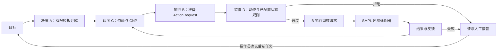

# 智能体系统中期成果与验收记录

日期：2026-11-06。依据：用户最新提供《项目修改后的版本.doc》及《项目中期报告.md》。本次仅覆盖智能体系统；仿真路线统一为 SMPL，mAbEnv 为主要研究对象，AtropineEnv 为辅助验证对象。

## 1. 可直接用于中期报告的进展正文

项目已形成由决策、调度、执行和监管四类 Agent 构成的 Python 系统原型，建立任务编号、子任务依赖、调度授予、候选动作请求、安全审核及执行反馈的数据交互链。系统提供统一任务入口，支持“检查状态”和“执行一次控制任务”两类有限模板目标，实现从结构化目标输入、任务分解、依赖调度、候选动作生成、独立监管审核到执行结果回传的闭环。当前采用同步本地调用，尚未实现跨进程通信。

决策模块采用基于规则和有限模板的 HTN 式任务分解，输出子任务顺序、依赖、能力要求、环境就绪前置条件及处理成功判据。当前并非通用 HTN 搜索器或大模型规划系统。控制任务分解为状态采集、目标检查、动作准备、安全审核、批准动作执行和结果验证六步。

调度模块实现简化合同网协议，包括任务发布、投标收集、能力/成本/负载评分、任务授予和执行反馈。多候选工作者调度器支持依赖顺序执行、工作者能力筛选、失败者排除和有界重新分配。未满足依赖的任务不启动，循环依赖返回未解决状态，避免无限循环。当前统一控制入口按角色进行单候选分配；多执行者竞争和重分配通过独立 Dispatcher 模块验证，尚未完成多个真实 SMPL 执行实例的集成实验。

执行模块采用来自项目 B 交付包的请求审核机制，候选动作与任务、子任务、请求编号和环境版本关联，执行前检查请求是否修改、消费或过期。监管模块使用实际动作空间进行形状、有限数值及上下界检查，拒绝动作不进入环境步进。新增可配置状态约束入口，每条规则要求标注来源并指定状态索引及边界；尚未加载经过工艺确认的 mAbEnv/AtropineEnv 状态阈值，因此不能声称已完成工艺机理安全保障。

系统增加异常后的人工接管请求及确认恢复机制。安全拒绝或执行失败后，系统进入接管请求状态，后续自主任务被锁定，须提供操作员标识及恢复原因后才能重新开始。该机制为进程内仿真接口，没有实现工业权限认证、远程告警、紧急停机执行器或独立 Web 界面。

仿真接入方面，保留 SMPL AtropineEnv 专用适配器，提供原 ZIP 中 SMPL 源码的安全提取工具；新增通用 Gym 环境适配层，兼容四项和五项 step 返回值，以便接入配置完成的 SMPL 环境。当前真实 SMPL 启动因云环境缺少 requests/gym 等依赖而未完成，依赖下载受到代理连通性限制。mAbEnv 的依赖安装、模型配置、环境初始化、状态语义及真实步进验证仍须完成。通用适配层测试通过不等于 mAbEnv 已适配验收。

本轮完成17项自动化测试，覆盖四角色闭环、只读任务、越界零步进、执行失败停止、重复运行、过期请求、竞争投标、失败重分配、依赖顺序、循环依赖退出、能力缺失、接管恢复、配置来源校验、状态规则及两类 Gym 接口。建立三个方向的确定性接口实验，保存240行原始记录、任务事件与统计汇总，为后续真实 SMPL 重复实验提供框架。

## 2. 系统结构和接口



- `AgentCluster.run(goal, action=None, seed=1101)`：每次重置环境，运行一个独立任务，返回任务、事件、耗时、子任务状态、执行结果和监管运行状态。
- `AgentCluster.run_batch(goals)`：多个独立 episode 顺序运行，首个失败后停止；不是连续工艺轨迹。
- `Dispatcher.execute(tasks, capabilities, handler, strategy, max_retries)`：可插入实际工作者处理函数，支持 fixed/cnp、失败重分配；单个环境的访问仍需保持串行。
- `Supervision.confirm_recovery(operator, reason)`：记录恢复理由后解除接管锁存；仿真接口，不提供身份认证。
- `MonitoringAgent(action_space, state_rules)`：状态规则格式为 `{index, low, high, source}`，不内置未经证实的工艺阈值。
- `GymEnvironmentAdapter(env, environment_name, source_dir)`：接收已创建的环境；不负责安装 mAbEnv 的依赖或构造其模型。

候选动作策略仍是 B 原有动作空间中点基线。该策略用于验证接口，不代表生产目标优化、PID、MADDPG或训练后的控制策略。任务 `constraints` 当前用于携带上下文，不会自动转成控制器约束；工艺安全规则必须显式配置给监管模块。

## 3. 缺口对照及本次补充

| 中期系统要求 | 本次处理 | 验收边界 |
|---|---|---|
| 四角色闭环 | 已实现，保留任务和子任务编号 | 同步单进程、有限目标 |
| 前置条件及完成判据 | 增加元数据，执行前环境就绪检查，执行后成功检查 | 不支持任意逻辑表达式或自动重规划 |
| CNP竞争与资源冲突 | 多候选模块、现有工作者锁、成本负载评分 | 真实多个SMPL工作者未联调 |
| 失败重分配 | 有界重试、排除失败者、依赖阻断 | 不对失败工艺动作自动重放，避免未知副作用 |
| 监管规则 | 输入/动作边界、可配置状态约束 | 待提供状态语义及有依据的阈值 |
| 人高于环 | 请求接管、确认恢复、事件记录 | 无远程权限和工业停机系统 |
| 重复运行与实验 | 17项测试、三类接口对照脚本与原始数据 | 均非真实工艺性能结论 |
| SMPL接入 | Atropine专用及通用Gym适配层、源码提取 | 实际环境验证未完成 |
| 中期材料 | 本报告、测试输出、数据、运行说明 | 不将计划目标写成已达指标 |

## 4. 接口实验结果及解释

实验采用二维确定性测试环境，30组运行，详见 `experiments/results/system/summary.json`；240行记录包括架构60行、调度60行、安全120行。没有在真实环境执行绕过监管的动作。

| 对照 | 结果 | 可以说明什么 |
|---|---|---|
| 单流程基线 / 四角色系统 | 任务成功均30/30 | 该夹具下两种接口路径均可完成；不能证明四角色效率提升 |
| 固定首选 / CNP | 0/30 与30/30 | 人为设定首选故障、高成本高负载，CNP能选健康候选；不是一般调度性能结论 |
| 监管开启 | 越界30/30拦截；正常0/30误拦截 | 已知动作边界规则的确定性行为 |
| 监管关闭的离线反事实 | 越界30/30被接纳 | 仅离线判断，无真实工艺危险动作执行 |

耗时是本机Python调用开销，包含四角色系统的任务组织及日志成本；不能据此计算生产效率、能耗、恢复时间或认定达到“提升20%”。调度固定基线不做备选切换，与CNP配置共同构成特定故障场景；需要更广泛场景及公平资源条件才能作研究结论。不同seed的任务夹具不是不同真实工况。

## 5. 仍须完成的SMPL验收

1. 在可联网的虚拟环境安装并锁定 SMPL 依赖，记录实际源码版本与平台；当前云环境安装步骤未完成。
2. 先对 AtropineEnv 完成真实 reset、单步、拒绝零步进及重复任务；再按新版项目书完成主环境 mAbEnv 的模型、资源及接口验收。
3. 明确 mAbEnv 上下游单元、状态变量、动作单位和控制周期；用这些信息建立实际跨工序任务，而不是用演示控制模板替代。
4. 提供工艺规则来源、状态阈值及故障/扰动定义，再开启相应状态安全规则。缺失数据不得编造。
5. 接入经确认的控制基线与目标指标，开展真实 SMPL 中的单Agent/PID/功能控制比较；另外实施固定/CNP和监管消融实验。统计生产完成、资源利用、恢复耗时及正常误拦截。
6. MADDPG、ZeroMQ、置信度评估、多模态模型及Web监管仍属于后续模块；本次没有完成这些研究内容。

最新项目书第六节仍有TEP残留用语，本报告按用户指令采用SMPL，未修改上传原件。项目书中写“主环境mAbEnv”，原中期稿写“Atropine先行、评估mAb扩展”，建议最终表述为“以AtropineEnv先行开展接口验证，按研究计划推进mAbEnv主环境验证”。

## 6. 复现

```bash
python -m pip install -r requirements.txt
python -m unittest discover -s tests -v
python -m experiments.evaluate_system
python -m runtime.unpack_smpl
# 完成SMPL依赖安装后：
python main.py --goal 执行一次控制任务
```

依赖安装和真实 SMPL 运行需要可用的网络及匹配的环境依赖。`requirements.txt` 只包含接口测试所需NumPy，不是完整SMPL锁文件。原ZIP的 `code/requirements-lock.txt` 可作为依赖线索，不能未经验证照搬为已复现环境。测试输出保存在 `docs/verification-tests.txt`。
